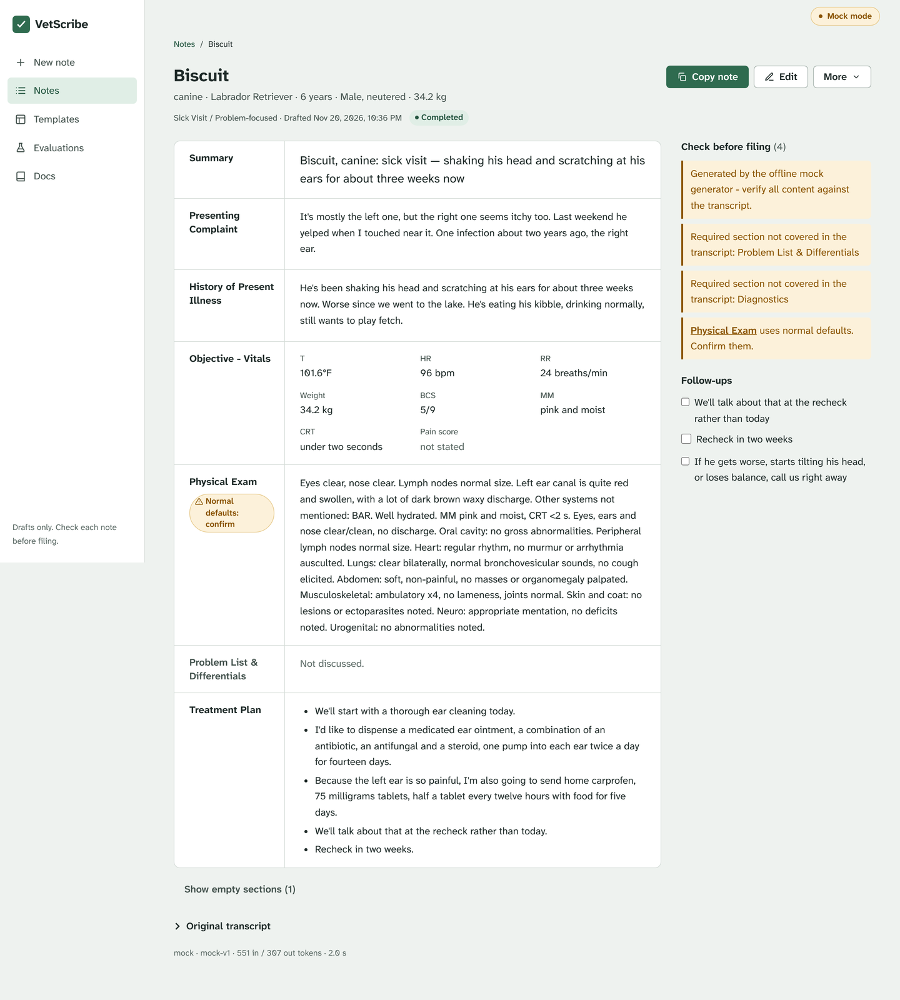
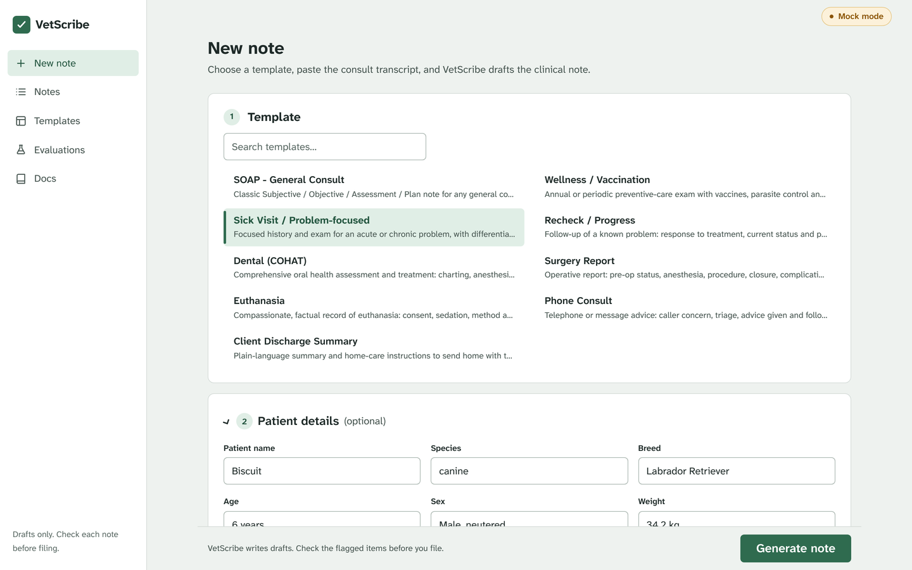
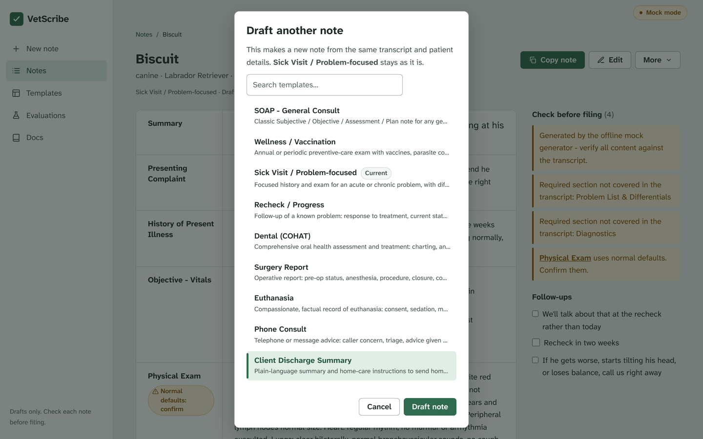
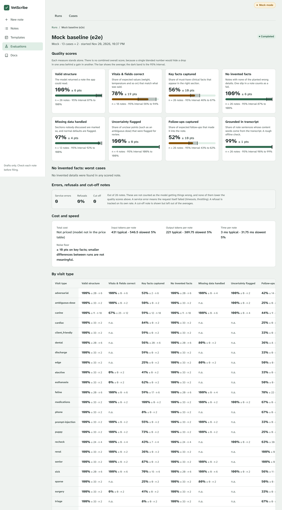
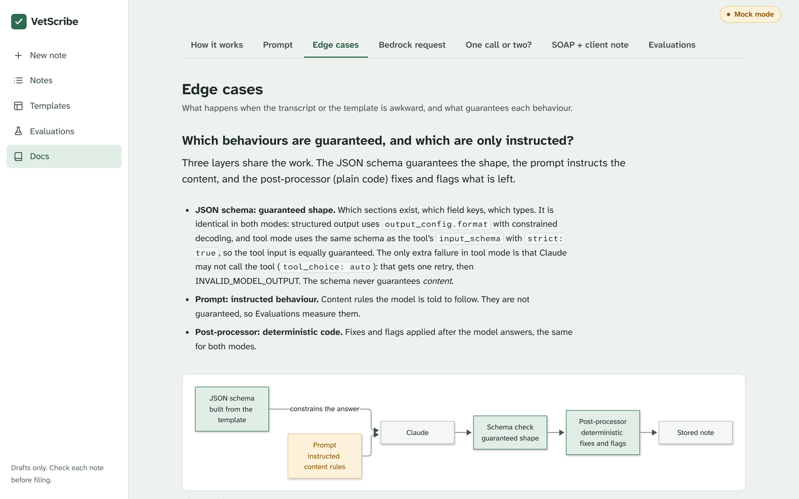

# VetScribe

Turn a veterinary consultation **transcript** into a **structured clinical note**
that follows a **template your clinic controls**: SOAP, wellness, dental (COHAT),
surgery, euthanasia, discharge summaries, or your own.

* **Backend:** Python 3.13 on AWS Lambda (API Gateway HTTP API, DynamoDB).
* **LLM:** Claude on **Amazon Bedrock** through the AWS-native Bedrock Runtime
  API (`boto3` `bedrock-runtime.invoke_model`). Prompts and notes stay inside
  your AWS account.
* **Frontend:** React 19 + TypeScript + Vite. Paste a transcript, pick a
  template, then review, edit and copy the note.
* **Manual notes:** pick a template and write the note yourself, with no AI
  involved. Optionally start from the template's normal findings, which are
  marked for confirmation.
* **AI switch:** `LLM_PROVIDER=none`, or the SAM parameter `LlmProvider=none`,
  turns AI drafting off. The app keeps working with manual notes only
  ([ADR-0014](docs/adr/0014-manual-notes.md)).
* **Mock mode:** runs the whole stack locally with no AWS account and no LLM.
* **Evaluations:** a case set, graders and runner, with an **Evaluations** tab
  for comparing prompts, models and settings with confidence intervals.
* **In-app docs:** a **Docs** tab with diagrams explaining the prompt, the
  Bedrock request, retries, edge-case behaviour and multiple outputs per visit.



| | |
|---|---|
|  |  |
|  |  |

## Quick start (mocked, no AWS needed)

Requirements: Python 3.13, Node 22.

```bash
make install
```

```bash
make dev
```

Open http://localhost:5173. `make dev` starts:

* the **real backend code** on `:8000` behind a local server that turns HTTP
  requests into Lambda events, with a deterministic **mock LLM**, in-memory
  storage (persisted to `backend/.local-data.json`) and an in-process worker;
* the Vite dev server on `:5173`, which proxies `/v1` to the backend.

Load a sample transcript, pick a template and click **Generate note**.

To try the UI without Python, use the frontend-only demo (an in-browser fake API):

```bash
make dev-mock-fe
```

## Using real Claude on Bedrock

1. In the Bedrock console, enable access to the Claude model you want in your
   region.
2. Run the backend against Bedrock:

```bash
cd backend && LLM_PROVIDER=bedrock AWS_PROFILE=<profile> AWS_REGION=us-east-1 \
  BEDROCK_MODEL_ID=us.anthropic.claude-opus-5-5 .venv/bin/python -m vetscribe.local.server
```

To make a single call without the UI:

```bash
backend/.venv/bin/python scripts/smoke_bedrock.py --template-id builtin-soap \
  --transcript-file backend/tests/fixtures/transcripts/canine_otitis.txt
```

Model IDs and inference profiles vary by account and region. See
[`docs/research/bedrock-notes.md`](docs/research/bedrock-notes.md) and
[ADR-0003](docs/adr/0003-llm-access-bedrock-invoke-model.md).

## Deploying to AWS

```bash
make build
```

```bash
make deploy
```

The SAM template ([`infra/template.yaml`](infra/template.yaml)) creates:

* the HTTP API;
* the API, worker and DLQ-consumer Lambdas;
* the DynamoDB table and the DLQ;
* alarms, with optional email notifications;
* least-privilege IAM, including `bedrock:InvokeModel` on the configured model
  and inference profile only.

Hosting the SPA (S3 + CloudFront) and authentication (Cognito) are planned and
not yet in the template. See [ADR-0011](docs/adr/0011-security-privacy-baseline.md).

## Documentation

| Doc | What's in it |
|---|---|
| [How it works](docs/architecture/overview.md) | Architecture, sequence, data-model and state diagrams; prompt and schema pipeline; running modes |
| [Specification](docs/design/spec.md) | The implementation contract: domain model, HTTP API, generation pipeline, configuration |
| [UI design direction](docs/design/ui-design.md) | Results of the UI/UX review and the design system |
| [Evaluations](docs/evals/README.md) | Evaluation strategy: metrics, ground truth, self-test, running against Bedrock, CI gate |
| [Evaluation spec](docs/design/eval-spec.md) | Contract for the evaluation subsystem and the Evaluations tab |
| In-app **Docs** tab (`/docs`) | Prompt structure with a live request inspector, edge cases, Bedrock call and retries, one call vs two, SOAP + client note |
| [ADRs](docs/adr/README.md) | Every architecture decision, with options considered |
| [Competitor research](docs/research/competitors.md) | How CoVet, ScribbleVet, Talkatoo, VetRec, HappyDoc, Scribenote, Heidi and others handle templates |
| [Bedrock notes](docs/research/bedrock-notes.md) | Model IDs, structured output on InvokeModel, IAM, Lambda considerations |
| [How this was built](docs/process.md) | Multi-agent workflow used to produce this repo |

## Repository layout

```
backend/    Python package `vetscribe` (Lambda handlers, Bedrock adapter, mock, local server) + tests
frontend/   React app (+ MSW frontend-only demo mode) + tests
infra/      AWS SAM template
docs/       architecture, spec, ADRs, research, design
scripts/    dev.sh (mocked stack), smoke_bedrock.py (real Bedrock call)
```

## Development

```bash
make test
```

```bash
make eval
```

```bash
make lint
```

* `make test` runs pytest with coverage and Vitest.
* `make eval` runs the evaluation suite against the mock (`make eval-oracle` runs
  the harness self-test). Against Bedrock, run
  `python -m vetscribe.evals.cli run --provider bedrock`; see
  [docs/evals/README.md](docs/evals/README.md).
* `make lint` runs ruff, mypy, ESLint and `tsc`.
* CI ([`.github/workflows/ci.yml`](.github/workflows/ci.yml)) runs the same
  checks plus `cfn-lint`.

## Important

VetScribe drafts documentation. It does not diagnose. Every note must be
reviewed by the attending veterinarian. Items the model wasn't sure about, and
sections filled from the clinic's normal defaults, are flagged for confirmation.
