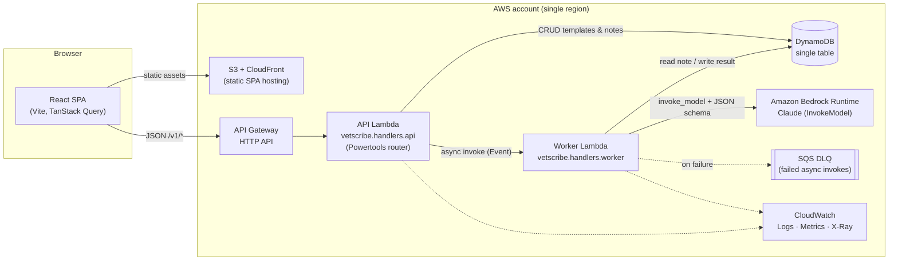
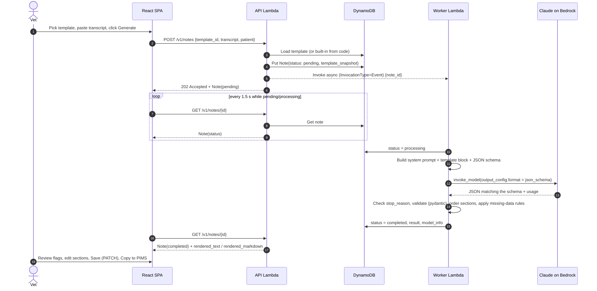
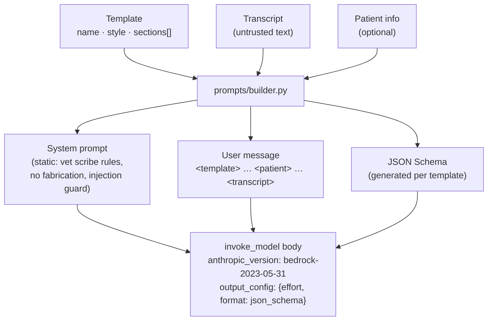
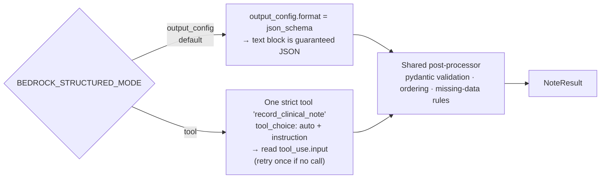
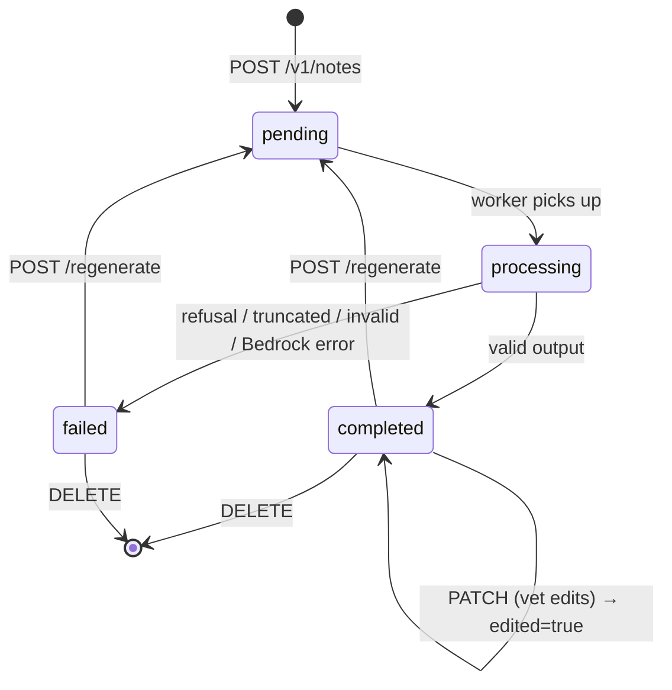
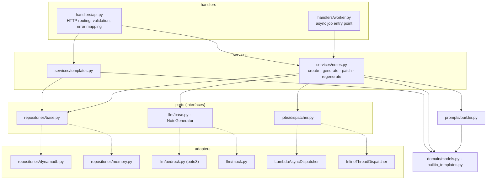
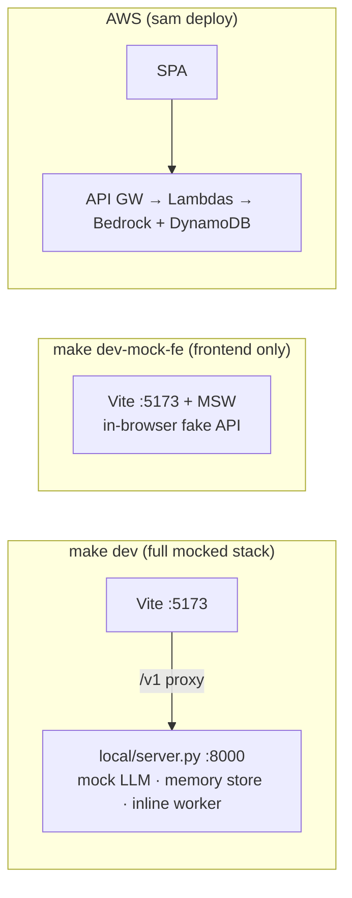

# VetScribe — How it works

VetScribe turns a veterinary consultation **transcript** into a **structured clinical
note** that follows a **template** the clinic controls. It assumes the transcript
already exists as one block of text, so speech-to-text is a separate, earlier step.

This page gives the high-level picture. The detailed contract is in
[`../design/spec.md`](../design/spec.md), and the decisions behind it are in the
[ADRs](../adr/README.md).

---

## 1. The big picture



| Component | Responsibility |
|---|---|
| **React SPA** | Template editor, paste-transcript screen, note viewer and editor, history. Polls while a note is generating. |
| **API Lambda** | One function behind every `/v1/*` route (a "lambdalith"). Validates input, manages templates and notes, and hands generation off to the worker. Returns quickly. |
| **Worker Lambda** | Builds the prompt and JSON schema from the template, calls Claude on Bedrock, validates and post-processes the output, then stores the note. |
| **DynamoDB** | Holds custom templates and notes in one table, partitioned by clinic. |
| **Amazon Bedrock** | AWS-hosted Claude, called with `boto3` `bedrock-runtime.invoke_model`. Prompts and outputs stay inside AWS. |

---

## 2. Generating a note, end to end



**Why asynchronous?** A long consultation with a large model can take longer than
API Gateway's roughly 30 s integration timeout, and Python Lambdas can't stream
responses natively. Returning `202` and polling keeps the API fast and simple. See
[ADR-0005](../adr/0005-asynchronous-generation.md).

---

## 3. How a template becomes a prompt and a schema

A template is an ordered list of **sections**. Each section says *what* to capture
(`instructions`), *how* to format it (`format`), and *what to do when the transcript
doesn't mention it* (`missing_behavior`).



The schema follows the template's own structure, so Claude has to return exactly
the sections the clinic defined:

| Section `format` | Schema shape returned by Claude | Rendered as |
|---|---|---|
| `paragraph` | `{content: string, not_discussed: bool, used_defaults: bool}` | Prose paragraph |
| `bullets` | `{items: string[], not_discussed, used_defaults}` | `- item` list |
| `key_value` | `{fields: {weight: string, temp: string, …}, not_discussed, used_defaults}` | `Weight: 32 kg` lines |

Every note also gets `visit_summary`, `action_items` (follow-ups, owner to-dos) and
`review_flags` (anything ambiguous the vet must check, such as an unclear dose).

### Missing-data semantics: the anti-hallucination rule

| `missing_behavior` | When the transcript is silent | Typical use |
|---|---|---|
| `omit` | Section is marked `not_discussed` and hidden from the final note | Optional sections like "Diet" |
| `state_not_discussed` | Prints "Not discussed." | Sections the record must always show |
| `use_normal_defaults` | Fills in the clinic's `normal_defaults` text, e.g. *"BAR, MM pink, CRT <2s"*, and sets `used_defaults: true`. The UI shows a **"Normal defaults — confirm"** badge. | Physical-exam body systems |

Findings mentioned in the transcript always override defaults. Defaults are never
applied silently.

---

## 4. Structured output strategies



* `output_config` is the default: native constrained decoding, so the model's
  output is guaranteed to match the schema.
* `tool` mode is a fallback for models or regions where `output_config` isn't
  available. Forced `tool_choice` is rejected by current Claude models, so this
  mode uses `auto` and retries once if Claude doesn't call the tool.
* Before reading any output, the worker checks `stop_reason`. `refusal` becomes
  `MODEL_REFUSAL` and `max_tokens` becomes `OUTPUT_TRUNCATED`. Both are stored on
  the note and shown in the UI.

---

## 5. Note lifecycle



---

## 6. Data model (DynamoDB single table)

```mermaid
erDiagram
    CLINIC ||--o{ TEMPLATE : owns
    CLINIC ||--o{ NOTE : owns
    TEMPLATE ||--o{ NOTE : "generated with (snapshot copied)"

    TEMPLATE {
        string PK "CLINIC#{clinic_id}"
        string SK "TEMPLATE#{uuid}"
        string name
        json sections "ordered Section[]"
        json style
        int version
    }
    NOTE {
        string PK "CLINIC#{clinic_id}"
        string SK "NOTE#{ulid}  (time-sortable)"
        string status "pending|processing|completed|failed"
        json template_snapshot
        string transcript
        json result "NoteResult"
        json model_info
    }
```

* **Built-in templates** (SOAP, Wellness, Sick visit, Recheck, Dental/COHAT,
  Surgery, Euthanasia, Phone consult, Client discharge) live in code, ship with
  each release, and are read-only. Duplicate one to customise it.
* **Template snapshot.** Each note stores a copy of the template it was generated
  with, so editing a template later never changes how an existing note is read.
* `clinic_id` is `default` until authentication lands. The planned approach is a
  Cognito JWT authorizer with the claim feeding the partition key.

---

## 7. Code structure (backend)



The ports-and-adapters split is what makes the **mock mode** possible. Each
adapter is chosen by an environment variable:

| Concern | AWS | Local / mock |
|---|---|---|
| LLM (`LLM_PROVIDER`) | `bedrock` → `llm/bedrock.py` | `mock` → `llm/mock.py` (keyword extraction, simulated latency) |
| Storage (`STORAGE_BACKEND`) | `dynamodb` | `memory` (+ optional JSON file) |
| Jobs (`JOB_DISPATCHER`) | `lambda` → async invoke of the worker | `inline` → background thread |
| HTTP entry | API Gateway → Lambda | `local/server.py` turns HTTP into API Gateway v2 events and calls the **same** `lambda_handler` |

---

## 8. Running modes



* **`make dev`** runs the real backend code paths (routing, validation, services,
  post-processing) with a fake LLM. Use it for most local work.
* **`make dev-mock-fe`** needs no Python. It's useful for UI-only iteration and demos.
* **Real Bedrock locally:** run `LLM_PROVIDER=bedrock AWS_PROFILE=… make dev-backend`,
  or try a single call with `scripts/smoke_bedrock.py`.

---

## 9. Security and privacy, in brief

* Transcripts and note contents are **never logged**. Logs carry only ids, sizes,
  timings and token counts.
* **Prompt-injection hardening:** the transcript is delimited and declared
  untrusted, the model is told to ignore instructions inside it, and the output
  is constrained by schema.
* **Least privilege:** the worker can call `bedrock:InvokeModel` only on the
  configured model and inference-profile ARNs. The API function can only
  read/write the table and invoke the worker.
* **Encryption** at rest (DynamoDB SSE, PITR) and in transit (TLS).
* **Data stays in AWS:** Bedrock doesn't use prompts or outputs to train models.
* **Clinician in the loop:** `review_flags` and `used_defaults` badges make the vet
  confirm uncertain content. VetScribe is a documentation aid, not a diagnostic tool.

See [ADR-0011](../adr/0011-security-and-privacy.md).
