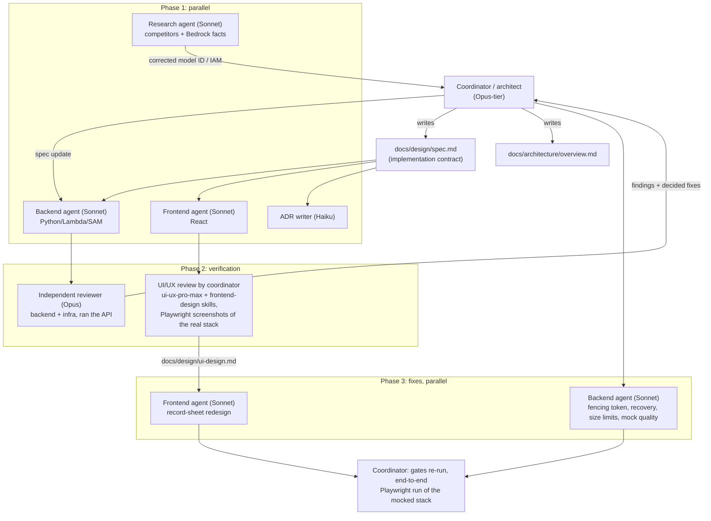

# How this was built

VetScribe was produced with a coordinated multi-agent workflow. A higher-capability
model acted as architect and coordinator. Lower-cost models implemented the work
against written contracts. Independent reviewers verified the result.

Ground rules the agents worked under:

* **Contracts first.** Agents built against `spec.md`, which let backend and
  frontend proceed in parallel without drifting.
* **Coordinator decides.** Reviewers report findings. The coordinator chooses the
  fix (recorded in ADRs) and hands precise instructions to implementers.
* **Verify, don't trust.** Every agent's "all green" was re-run by the
  coordinator (ruff, mypy, pytest, cfn-lint, ESLint, tsc, Vitest, build) before
  commit, and the UI was checked with screenshots of the real stack.
* **No personal memory.** No account memory or personal notes were used. Facts
  came from the repo, public documentation and web research, with sources cited
  in `docs/research/`.
